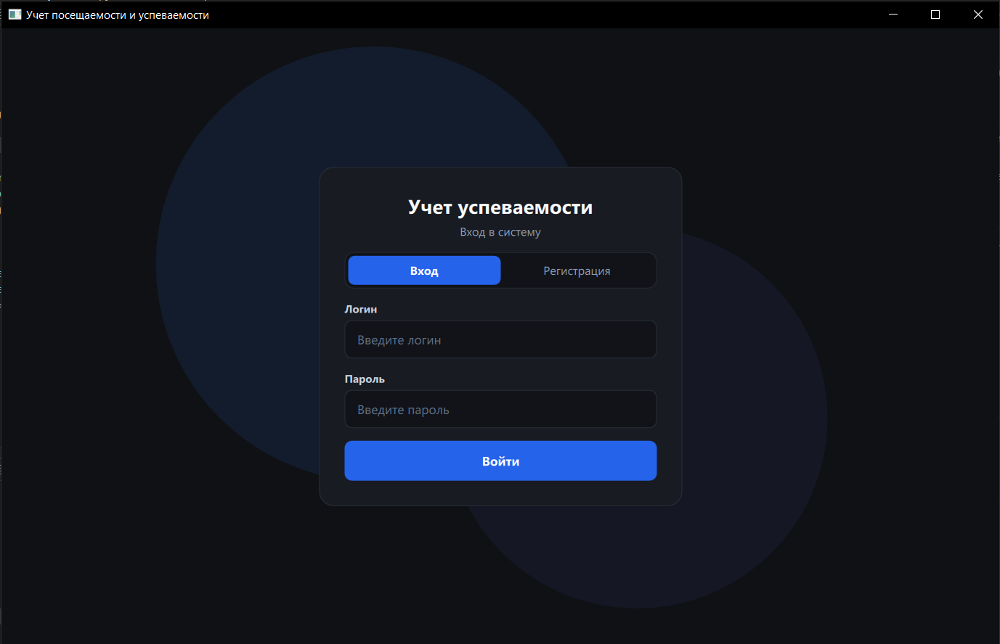
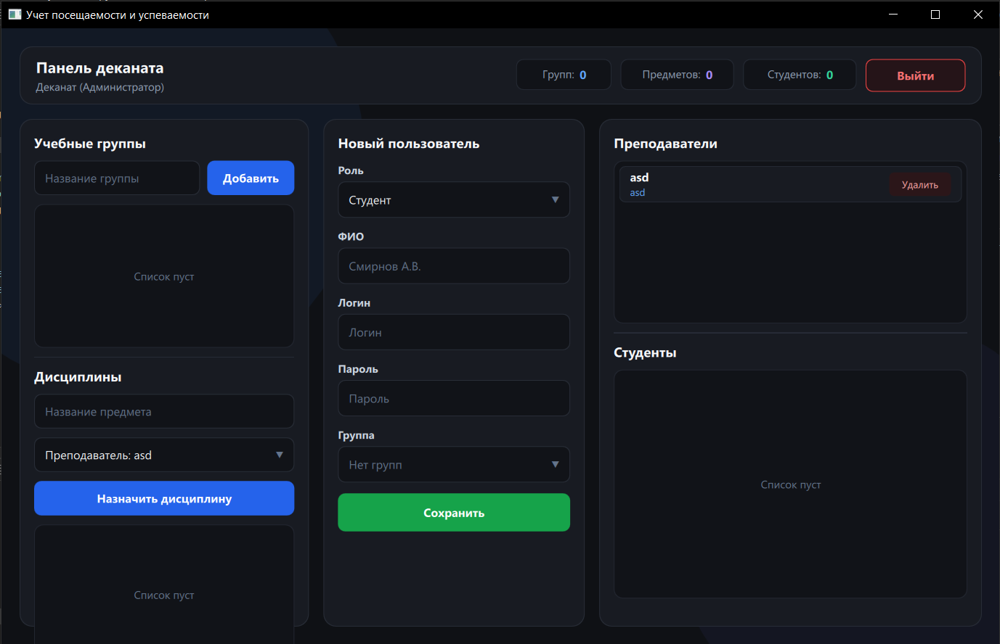
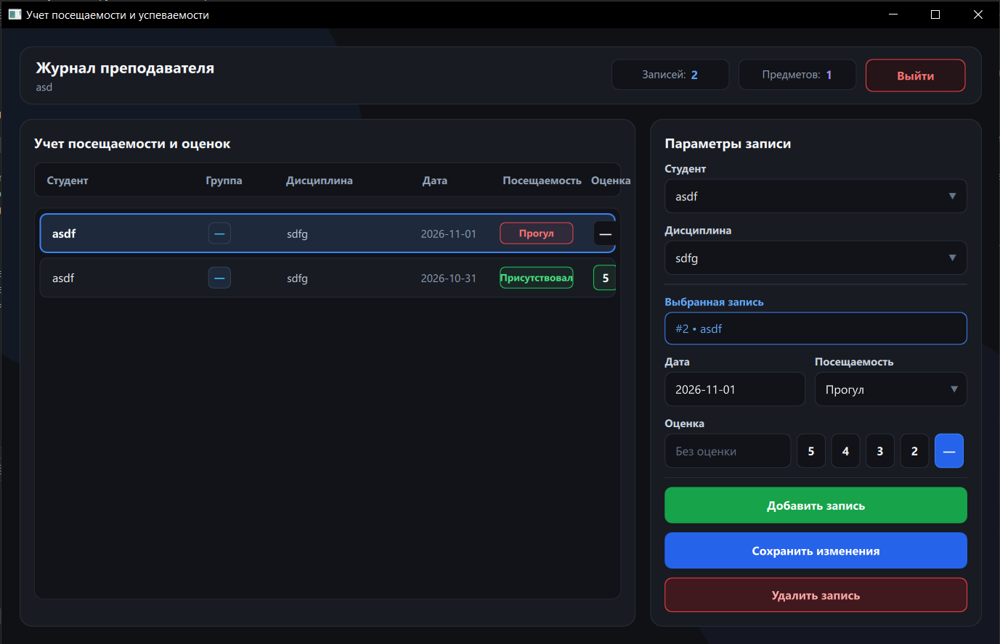
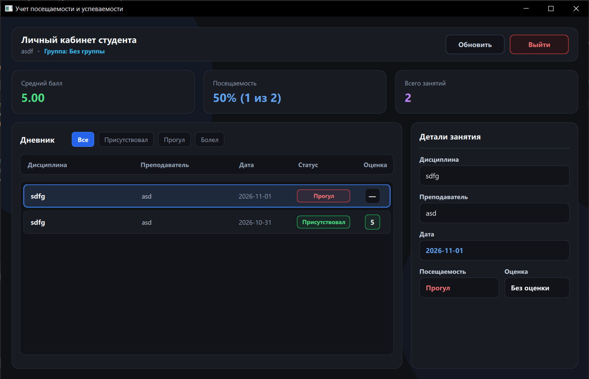

# Учет посещаемости и успеваемости студентов

Десктопное приложение на C++ (Qt 6 / QML) и SQLite для ведения электронного журнала успеваемости и посещаемости.

## Функционал

* **Деканат:** создание учебных групп, добавление дисциплин, регистрация преподавателей и студентов.
* **Преподаватель:** ведение журнала посещаемости, выставление и редактирование оценок.
* **Студент:** просмотр своих оценок, фильтрация по посещаемости, расчет среднего балла и процента посещаемости.

## Структура базы данных

Используется локальная база SQLite (`university.db`), состоящая из 4 таблиц:
* `groups` — учебные группы
* `users` — пользователи системы (`dean`, `teacher`, `student`)
* `subjects` — дисциплины
* `journal` — записи о посещаемости и оценках

Данные для входа администратора по умолчанию:
* Логин: `dean`
* Пароль: `123`

## Скриншоты

### Авторизация

### Панель деканата

### Журнал преподавателя

### Личный кабинет студента

## Сборка

1. Открыть `CMakeLists.txt` в Qt Creator.
2. Выбрать комплект Qt 6 (MinGW / MSVC).
3. Собрать и запустить проект.